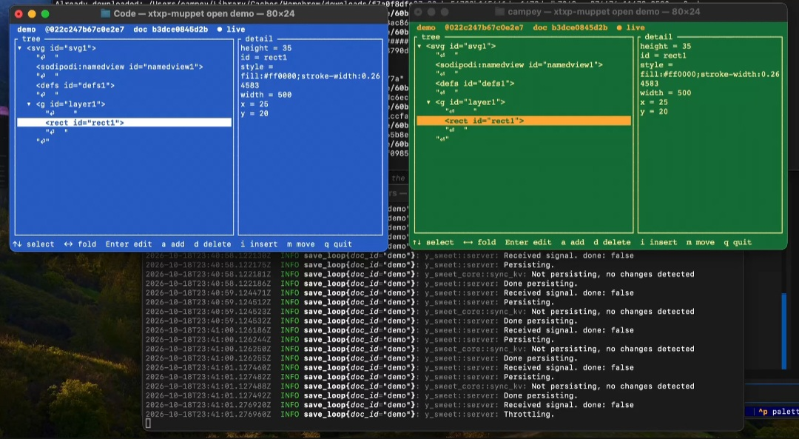

*Written 19 October 2026, when M1-y-sweet was finished.*

M1-y-sweet is the first working XTXP code. Two people, each in a terminal, edit the same SVG drawing through a stock, unmodified [y-sweet](/discussion/prior-art/#y-sweet) v0.9.1, and each sees the other's changes arrive live. It is the first half of the y-sweet spike ([decision 25](/discussion/decisions/#25-run-m1-and-m2-on-a-stock-y-sweet-first)), and it is command line only. Browsers and Inkscape come with M2-y-sweet.

*Two muppets, one blue and one green, on the same drawing through one y-sweet, whose log runs behind them. Both show the same snapshot and document hashes in their headers, and the same value for `width`.*

## What was built

All of it is in [`xtxp-rs`](https://github.com/xtxp-link/xtxp-rs), and `scripts/try-it.sh` runs it on a Mac or Linux machine.

| Piece | What it does |
| --- | --- |
| **Xmesh** | The CRDT engine: XML documents on Yrs 0.28's XML types, [canonical form v0](/spec/math/#canonical-form-v0), snapshot hashes, and node IDs that follow a node while its path shifts. |
| **`xtxp-wire`** | The peer side of the Yjs sync protocol as y-sweet speaks it, as a pure state machine. |
| **`xtxp-muppet`** | A local [muppet](/overview/architecture/): a terminal UI for browsing and editing a live document, and one-shot commands (`init`, `edit`, `show`, `replay`) for scripts and tests. It reconnects with backoff and a fresh client ID each time. |
| **Chaos proxy** | Sits between muppets and y-sweet, and delays and duplicates frames and drops connections. |
| **Vectors, fuzzer and probes** | 14 hand-written [test vectors](/build/verification/), a fuzzer that checks 500 seeds, and a probe that replays every vector on y-sweet's older Yrs 0.19.2. |

In the terminal UI, a person selects a node and changes it: they edit attributes and text, add, remove or nudge numeric attributes with the arrow keys, insert children, and delete or move nodes. Edits are aimed at the node itself, so they still land where intended when someone else's edit has moved it.

## What it showed

- **Live editing works through a stock y-sweet.** End-to-end tests run three muppets at once, as separate processes, through the chaos proxy against a real y-sweet. They converge, and a late joiner loads the whole document in one update. Edits made while disconnected survive reconnects with fresh client IDs. A y-sweet restart loses nothing.
- **Real hands find what tests don't.** A first try in two terminals worked, and it raised small questions that turned into changes the same day: how to add an attribute or a node, quitting with Ctrl-C, and nudging numbers with the arrow keys.
- **y-sweet's acknowledgement only means "received".** y-sweet echoes a message to say it has an update, but an update it can't integrate yet is echoed like any other. Two of the bugs below were invisible to every peer. The tests caught them only by comparing what a late joiner gets.

## Findings

Testing against a real y-sweet found four problems. Each has a test that reproduces it, and the upstream reports are tracked in [xtxp-link/xtxp-rs#4](https://github.com/xtxp-link/xtxp-rs/issues/4).

1. **A use-after-free in Yrs 0.28** (upstream). An update that lists the same blocks twice, applied to a document that integrated past a gap, makes Yrs free memory it still uses, and the next read crashes. It brought the muppet down in about 1 run in 25. Xmesh now merges each incoming update on its own before applying it, which drops the repeats. This is the most important report, because it is memory unsafety reached through Yrs's safe API.
2. **y-sweet sends updates that list blocks twice** (upstream). y-sweet's Yrs 0.19.2 produced exactly the repeated update that sets off the first finding.
3. **Client IDs above 32 bits are mangled** (upstream). Yrs 0.19.2 reads client IDs as 32-bit, so a larger ID becomes a different client inside y-sweet. Xmesh now uses 32-bit client IDs, as Yjs does.
4. **Lost edits from before the first sync** (ours, fixed). An update applied before what it builds on had arrived was left out when the muppet copied its document on reconnect. y-sweet held only the starting drawing, while the muppet reported success.

Part 1 had already found two Yrs 0.28 bugs and that Yrs 0.19.2 loses a delete arriving before its insert. They are listed in the [part 1 design](https://github.com/xtxp-link/website/blob/main/docs/plans/2026-10-18-m1-y-sweet-part-1-design.md#9-findings-to-carry-into-the-spikes-write-up). The [part 2 design](https://github.com/xtxp-link/website/blob/main/docs/plans/2026-10-18-m1-y-sweet-part-2-design.md#10-findings) has these four in detail.

## What y-sweet can't do

These are recorded as gaps, not built:

- **Admission by session, key grants and the signed handshake.** y-sweet admits per connection, with bearer tokens, and starts syncing before any handshake.
- **Auth of any kind in this spike.** It runs with none, so it is for one machine or a trusted network. Token auth is the next step.
- **Knowing an update was integrated.** Its acknowledgement can't tell "integrated" from "stuck waiting", as above.
- **A current Yrs.** Its Yrs 0.19.2 is behind fixes that XTXP relies on: three of the findings above come from that version gap.

## The browser: M2-y-sweet, part A

*Added 19 October 2026.* The first half of M2-y-sweet puts the same document in a browser, watch-only for now ([design](https://github.com/xtxp-link/website/blob/main/docs/plans/2026-10-19-m2-y-sweet-browser-design.md)). `xtxp-muppet serve` is a server-side muppet: one more peer of the y-sweet document, which renders it as HTML with inline SVG and sends each change to every viewer as a [declarative partial update](/spec/browser/), in three ways:

- **refresh:** the page reloads every second, and unchanged polls get `304 Not Modified`. No JavaScript.
- **stream:** the page's response stays open, and each change arrives as a `<template for>` patch the browser applies itself. No JavaScript, Chrome and Edge 150 or later.
- **WebSocket:** a small polyfill applies the same patches in any modern browser.

### What the browsers did

Probed automatically in Chromium 158 (a trunk snapshot, with native `<template for>`) and Chromium 141 (without), in [`tests/browser`](https://github.com/xtxp-link/xtxp-rs/tree/main/tests/browser):

| Question | Answer |
| --- | --- |
| Can a page detect native `<template for>`? | Yes: parse a marker pair and a template with `Document.parseHTMLUnsafe` and check the result. |
| Can a native patch replace one SVG element? | **No.** Patch content is parsed in an HTML context, so a `<rect>` comes out as an HTML element and never draws. Native streaming patches the whole `<svg>` instead; per-element SVG patches need the polyfill, which parses in the SVG's context. |
| Does a streamed patch start a view transition by itself? | **No.** It applies instantly. Animating it needs one `document.startViewTransition()` call, which needs script. |
| Do elements inside an SVG get their own view transition? | **No**, in either browser. Only the `<svg>` box takes part, so a change inside the drawing animates as a cross-fade of the whole drawing. |

### How the modes compare

In the build container, with the logo changing 5 times a second through a real y-sweet, measured from the edit leaving the editor to the change reaching each viewer:

| Mode | Latency p50 | Bandwidth per viewer |
| --- | ---: | ---: |
| refresh (1 s poll) | about 500 ms | 2.5 KB/s |
| stream, whole drawing | about 2 ms | 9.1 KB/s |
| stream, changed elements | about 2 ms | 1.5 KB/s |
| WebSocket, changed elements | about 2 ms | 1.5 KB/s |
| WebSocket, whole drawing | about 2 ms | 9.0 KB/s |

At 1 and 10 viewers the server used under 1% of a CPU and under 10 MB of memory. These are one machine's numbers, for comparing the modes with each other. The full matrix, up to 1,000 viewers, and a run in David's own Chrome follow the [checklist](https://github.com/xtxp-link/website/blob/main/docs/plans/2026-10-19-m2-y-sweet-browser-checklist.md) and will be added here.

## What's next

- **M2-y-sweet, the rest:** editing from the browser (forms and handles), sharing a link with someone else, which brings in y-sweet's token auth, and the Inkscape fork.
- **Then the decision** this spike exists for: whether the full M1 and M2 keep y-sweet as the host, or build XTXP's own host borrowing from it. These findings, especially the version gap and the acknowledgement, are the evidence.

To try it yourself, follow "Try it" in the [`xtxp-rs` README](https://github.com/xtxp-link/xtxp-rs#try-it).
